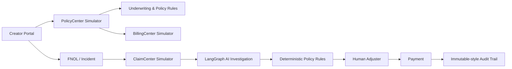

# CreatorShield AI
## Intelligent Cyber Insurance & Claims Management Platform for Digital Creators

CreatorShield AI is a **Guidewire-inspired insurance core simulator** for a creator-focused cyber insurance product. It is designed for a Guidewire interview/demo when the team does not have access to a licensed PolicyCenter, ClaimCenter or BillingCenter environment.

> Important: this project does **not** claim to be Guidewire software. It models the responsibilities, data concepts, rules and workflows of the three centers so the simulator can later be replaced by real Guidewire integrations.

## Product scope

The concept is based on the provided opportunity document: a proposed Creator Digital Asset & Account Hijacking Shield protecting creators against specified account compromise/restriction losses, including professional recovery expenses, specialized legal expenses and eligible revenue interruption.

## Core workflow



 ## Functional demo paths

 - Create a creator account, register a digital platform account and declare security controls.
 - Calculate a quote. Standard quotes can be bound into a policy and billing account.
 - Pay the simulated first invoice to activate the policy.
 - Submit a FNOL with claimed exposure amounts and the incident/restoration dates.
 - Add evidence references. References remain pending until an adjuster verifies the document and, for financial evidence, its supported amount.
 - Run the LangGraph investigation, deterministic coverage/loss assessment and human adjuster decision.
 - Record a simulated claim payment, close the claim and inspect its audit events.

 The evidence interface stores a filename/reference and adjuster-verified amount; it does not upload or scan the referenced file. Billing and claim payment actions are local demonstrations and do not move real money.

## Three-center model

| Guidewire concept | Simulator responsibility |
|---|---|
| PolicyCenter | Account, product, quote, underwriting, policy period, coverages, bind/issue, renewal/cancellation concepts |
| ClaimCenter | FNOL, claim, exposures, evidence, investigation, coverage review, loss assessment, adjudication, payment |
| BillingCenter | Billing account, invoice, due dates, payment state, outstanding balance, collections/cancellation concepts |

## AI architecture

```text
Incident
  -> Triage Agent
  -> Evidence Investigation Agent
  -> Risk Review Agent
  -> Deterministic Policy Rules
  -> Loss Assessment
  -> Human Adjuster
  -> Payment
```

AI is assistive. It cannot override policy rules or approve a consequential payment.

## Policy rules included

- Policy period validation
- Covered-event validation
- Required security controls
- Minimum adjuster-verified evidence threshold
- Verified amount limits for recovery, legal and revenue exposures
- Coverage-specific limits
- Aggregate policy limit
- Deductible
- Revenue interruption daily benefit and waiting period
- Human-review/referral principle
- Valid claim state transitions

## Demo claim

Synthetic example, with a one-day waiting period and five elapsed interruption days:

- Recovery: ₹30,000
- Legal: ₹10,000
- Claimed revenue interruption: ₹25,000
- Eligible interruption: ₹20,000 (4 days × ₹5,000/day)
- Gross eligible: ₹60,000
- Deductible: ₹5,000
- Illustrative payout: ₹55,000

## Local setup

### Backend

Python 3.14 is supported by the current dependency set.

```powershell
cd backend
python -m venv .venv
.\.venv\Scripts\Activate.ps1
pip install -r requirements.txt
uvicorn app.main:app --reload
```

API docs: http://localhost:8000/docs

### Frontend

Node.js 20+ recommended.

```powershell
cd frontend
npm install
npm run dev
```

Open http://localhost:5173

### Demo credentials

Creator:
`creator@example.com` / `Creator@123`

Adjuster:
`adjuster@example.com` / `Adjuster@123`

## Project structure

```text
CreatorShieldAI/
  frontend/             React + TypeScript user experience
  backend/              FastAPI + SQLAlchemy insurance core
  guidewire/             PolicyCenter/ClaimCenter/BillingCenter reference artifacts
  docs/                  architecture, workflows and interview material
```

## Production evolution

1. Replace SQLite with PostgreSQL.
2. Replace evidence references with private object storage, malware scanning and controlled reviewer access.
3. Replace demo JWT authentication with a production identity provider and managed signing secrets.
4. Replace simulator boundaries with Guidewire APIs/events when a licensed environment is available.
5. Add production policy/product configuration, renewals, endorsements and cancellation workflows.
6. Add reserve management and full ClaimCenter exposure workflows.
7. Integrate a real payment provider and BillingCenter invoices/collections.
8. Add model evaluation, prompt/version tracking and AI observability.
9. Add CI/CD, secrets management, tracing and monitoring.

Set `APP_ENV=production` and provide a strong `SECRET_KEY` through deployment secrets; the checked-in demo default is rejected in production mode.

See the [API map](./docs/api.md), [business rules](./docs/business-rules.md), [AI workflow](./docs/ai-workflow.md), [data model](./docs/data-model.md), and [Guidewire mapping](./docs/guidewire-mapping.md).
